<!-- The banner is a real Monte Carlo run, animated with CSS inside the SVG: 20,000
     simulated stock paths, a sample tracing out in 3D, the histogram of where they
     ended filling in toward the exact lognormal density, and the running call price
     next to Black-Scholes. Regenerate with `python3 make_banner.py`. -->

<picture>
  <source media="(prefers-color-scheme: dark)" srcset="banner-navy-dark.svg">
  
</picture>

Hi! I'm Sanjay. I study **Mathematics & Computing** (Mathematical Intelligence &
Data Science) at **Georgia Tech**, and I'm the co-founder and CEO of
**SAAChronicle (Sacron)**, a ML optimization startup.

<picture>
  <source media="(prefers-color-scheme: dark)" srcset="skills-dark.svg">
  
</picture>

<picture>
  <source media="(prefers-color-scheme: dark)" srcset="divider-dark.svg">
  
</picture>

## &#9670;&nbsp; Sacron

<picture>
  <source media="(prefers-color-scheme: dark)" srcset="sacron-trace-dark.svg">
  
</picture>

<picture>
  <source media="(prefers-color-scheme: dark)" srcset="sacron-scores-dark.svg">
  
</picture>

<p>
  
  
</p>

<picture>
  <source media="(prefers-color-scheme: dark)" srcset="divider-dark.svg">
  
</picture>

## &#9654;&nbsp; [Aquatic Twin: a live 3D model of Lake Erie](https://github.com/sjfan910/grokathon2026)


<sub>Recorded from the running solver and sped up. A bloom grows from Maumee River phosphorus, an oil spill hits the water, and the currents reroute when the wind changes. Recording by <a href="https://github.com/superkush06/aquatic-twin">superkush06</a>.</sub>

Built with teammates at the **2026 BDBI × SpaceXSI Grokathon**. *Pollute Lake Erie
anywhere, change the wind, and watch the water, the fish and the local economy
respond.* Phosphorus, algae, oxygen, toxin, heat and oil are solved live in
the browser on **NOAA's real lakebed**, across **12 depth layers**. Currents come
from a wind-driven streamfunction that **conserves water by construction**. An
AI operator tests cleanup plans on copies of the solver and applies the best
one.

**My part:** the **oil-spill physics** in the solver (click anywhere to spill,
and the slick follows the currents), the **fish-market economics** that price
what a bloom or spill costs local fisheries, and the tests for both.

**Run it locally** from [sjfan910/grokathon2026](https://github.com/sjfan910/grokathon2026):

```bash
git clone https://github.com/sjfan910/grokathon2026 && cd grokathon2026
pip install -r aquatic-twin/requirements.txt
python aquatic-twin/run.py
```

Then open **http://localhost:5001/water**. It runs without an API key, using
a labelled simulated operator. There's also a
[browser-only demo](https://superkush06.github.io/aquatic-twin/), no install
needed.

<picture>
  <source media="(prefers-color-scheme: dark)" srcset="divider-dark.svg">
  
</picture>

## Now

**Co-founder & CEO, SAAChronicle (Sacron)**\
Building an *ML optimization startup* from the ground up.

**SimpliEarn, Big Data Big Impact @ Georgia Tech** &nbsp;·&nbsp; financial research & SWE, 09/26 – now\
**Earnings-call sentiment signals** and **prediction-market analysis**. I'm adapting
options theory to model *asymmetric probability distributions* for text
forecasting, and fixing backend and RAG logic in the team's codebase.

<picture>
  <source media="(prefers-color-scheme: dark)" srcset="divider-dark.svg">
  
</picture>

## Projects

**[probability-wave](https://github.com/sanjaymav7/probability-wave)** &nbsp;·&nbsp; forecast USD/INR as a density that flows\
Price action as a **probability density** moved forward by the **Fokker-Planck
equation**, with mean reversion and local volatility, on a finite-volume grid
that *can't leak probability*. Over **1,312 rolling windows** it beats a random
walk by **12.1%** CRPS and a gradient-boosting quantile model by **6.5%**.
Empirical-Bayes shrinkage of the noisy per-window fits adds a further **1.0%**.

<picture>
  <source media="(prefers-color-scheme: dark)" srcset="https://raw.githubusercontent.com/sanjaymav7/probability-wave/main/docs/fan_dark.svg">
  
</picture>

<sub>A year of 20-day-ahead forecasts, each made only from data available that day. Bands are the 50% and 90% ranges of the forecast density, and red is what happened. From <a href="https://github.com/sanjaymav7/probability-wave">probability-wave</a>.</sub>

**[hd-modifier-forest](https://github.com/sanjaymav7/hd-modifier-forest)** &nbsp;·&nbsp; Huntington's on real GEO cohorts, with an honest AUC\
The random-forest pipeline from my research with **Dr. Asha Pillai**, rebuilt
after finding that *three of its four datasets never loaded*, so it had
trained on **14 people**. Now it covers **207 samples** with nested CV and covariates
removed in-fold. In prefrontal cortex it reaches **AUC 0.996** after
adjustment, ranking developmental HOX genes on top as the original study
found. In blood it **doesn't beat age alone**, and the README says so.

<picture>
  <source media="(prefers-color-scheme: dark)" srcset="https://raw.githubusercontent.com/sanjaymav7/hd-modifier-forest/main/docs/auc_dark.svg">
  
</picture>

**[partition-primes](https://github.com/sanjaymav7/partition-primes)** &nbsp;·&nbsp; integer partitions that detect the primes\
MacMahon's partition functions in **exact integer arithmetic**, and the
Craig-Ono-Rolen identities that are *zero exactly at the primes*, verified for
**every n up to 400**. It's the base for my paper on prime detection with
quasimodular partition variants.

<picture>
  <source media="(prefers-color-scheme: dark)" srcset="https://raw.githubusercontent.com/sanjaymav7/partition-primes/main/docs/criterion_dark.svg">
  
</picture>

**[options-lab](https://github.com/sanjaymav7/options-lab)** &nbsp;·&nbsp; Black-Scholes to Heston to Bates, each checked\
Prices and greeks, an American-exercise binomial lattice, and Heston and Bates
by characteristic-function inversion. **15 of 15 checks pass**: against Hull's
worked examples, put-call parity to **7e-15**, greeks against finite differences,
and Heston and Bates against **200,000-path Monte Carlo** at three strikes.

<picture>
  <source media="(prefers-color-scheme: dark)" srcset="https://raw.githubusercontent.com/sanjaymav7/options-lab/main/docs/smile_dark.svg">
  
</picture>

<picture>
  <source media="(prefers-color-scheme: dark)" srcset="divider-dark.svg">
  
</picture>

## Experience

| | | |
| :-- | :-- | :-- |
| **SAAChronicle (Sacron)** | Co-founder & CEO | now |
| **SimpliEarn**, Big Data Big Impact @ Georgia Tech | Financial research & SWE | 09/26 – now |
| **AI Sense**, UMBC | Lead intern, AI/ML team | 11/24 – 05/26 |
| **Solving Generational Huntington's** | Student researcher under Dr. Asha Pillai | 01/26 – 05/26 |

- **Exeter22:** built a mean-reversion strategy tracking privately traded
  companies (**1.45 Sharpe**, **2.1% tracking error**), with a binomial lattice for
  early exercise, and *led the capstone presentation* to Exeter22's CEO.
- **AI Sense:** trained pose-detection and CNN models for agricultural
  technology serving **50+ farmers**, including **PoseGuard**, a low-latency
  pose-estimation system on renewable power that flags intrusions and crop
  issues.

<picture>
  <source media="(prefers-color-scheme: dark)" srcset="divider-dark.svg">
  
</picture>

## Writing & talks

- *Application of Partition Variants in Prime Detection*, in submission
- *Properties of Alternating Sequences*, HCPSS Math Journal
- *A Nonpareil Margin (Part One)*, a historical novel about ethics in British
  India, **#1 Amazon Bestseller** in Indian Literary Criticism
- **Main panelist** at the Student Leadership Conference (2025), on diagnosing
  autism with an optimised CNN

<picture>
  <source media="(prefers-color-scheme: dark)" srcset="divider-dark.svg">
  
</picture>

## Outside the code

**Indian classical music**, **philosophy**, **number theory**, **tennis** and **poker**.

Reach me at **sanjay.mavalli@gatech.edu** or on
[LinkedIn](https://www.linkedin.com/in/sanjay-mavalli-912062322).
