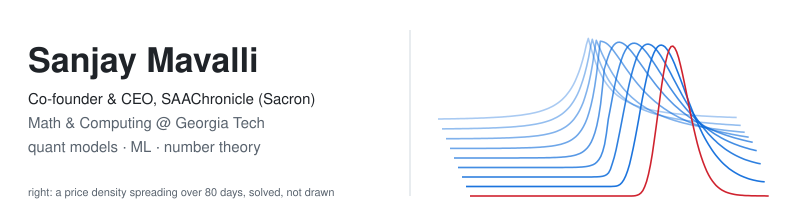

<!-- The curves in the banner are a real Fokker-Planck solve from probability-wave,
     not an illustration. Regenerate with `python3 make_banner.py`. -->

<picture>
  <source media="(prefers-color-scheme: dark)" srcset="banner-dark.svg">
  
</picture>

Hi! I'm Sanjay. I study Mathematics & Computing (Mathematical Intelligence &
Data Science) at Georgia Tech, and I'm the co-founder and CEO of
**SAAChronicle (Sacron)**, a ML optimization startup. Pricing models
against textbook values and Monte Carlo, a PDE solver against its closed
form, and forecasters scored over a thousand-plus windows.

**Python · NumPy · SciPy · scikit-learn · C++ · Java · Node · Django · React · Vite**

## Now

**Co-founder & CEO, SAAChronicle (Sacron)**\
Building it from the ground up.

**SimpliEarn, Big Data Big Impact @ Georgia Tech** &nbsp;·&nbsp; financial research & SWE, 09/26 – now\
Earnings-call sentiment signals and prediction-market analysis. I'm adapting
options theory to model asymmetric probability distributions for text
forecasting, and fixing backend and RAG logic in the team's codebase.

## Projects

**[probability-wave](https://github.com/sanjaymav7/probability-wave)** &nbsp;·&nbsp; forecast USD/INR as a density that flows\
Price action as a probability density moved forward by the Fokker-Planck
equation, with mean reversion and local volatility, on a finite-volume grid
that can't leak probability. Over **1,312 rolling windows** it beats a random
walk by **12.1%** CRPS and a gradient-boosting quantile model by 6.5%.
Empirical-Bayes shrinkage of the noisy per-window fits adds a further 1.0%.

<picture>
  <source media="(prefers-color-scheme: dark)" srcset="https://raw.githubusercontent.com/sanjaymav7/probability-wave/main/docs/fan_dark.svg">
  
</picture>

A year of 20-day-ahead forecasts, each made only from data available that day. Bands are the 50% and 90% ranges of the forecast density, and red is what happened. From <a href="https://github.com/sanjaymav7/probability-wave">probability-wave</a>.

**[options-lab](https://github.com/sanjaymav7/options-lab)** &nbsp;·&nbsp; Black-Scholes to Heston to Bates, each checked\
Prices and greeks, an American-exercise binomial lattice, and Heston and Bates
by characteristic-function inversion. **15 of 15 checks pass**: against Hull's
worked examples, put-call parity to 7e-15, greeks against finite differences,
and Heston and Bates against 200,000-path Monte Carlo at three strikes.

<picture>
  <source media="(prefers-color-scheme: dark)" srcset="https://raw.githubusercontent.com/sanjaymav7/options-lab/main/docs/smile_dark.svg">
  
</picture>

**[hd-modifier-forest](https://github.com/sanjaymav7/hd-modifier-forest)** &nbsp;·&nbsp; Huntington's on real GEO cohorts, with an honest AUC\
The random-forest pipeline from my research with Dr. Asha Pillai, rebuilt
after finding that three of its four datasets never loaded, so it had
trained on 14 people. Now it covers 207 samples with nested CV and covariates
removed in-fold. In prefrontal cortex it reaches **AUC 0.996** after
adjustment, ranking developmental HOX genes on top as the original study
found. In blood it **doesn't beat age alone**, and the README says so.

<picture>
  <source media="(prefers-color-scheme: dark)" srcset="https://raw.githubusercontent.com/sanjaymav7/hd-modifier-forest/main/docs/auc_dark.svg">
  
</picture>

**[partition-primes](https://github.com/sanjaymav7/partition-primes)** &nbsp;·&nbsp; integer partitions that detect the primes\
MacMahon's partition functions in exact integer arithmetic, and the
Craig-Ono-Rolen identities that are zero exactly at the primes, verified for
every n up to 400. It's the base for my paper on prime detection with
quasimodular partition variants.

<picture>
  <source media="(prefers-color-scheme: dark)" srcset="https://raw.githubusercontent.com/sanjaymav7/partition-primes/main/docs/criterion_dark.svg">
  
</picture>

## Experience

| | | |
| :-- | :-- | :-- |
| **SAAChronicle (Sacron)** | Co-founder & CEO | now |
| **SimpliEarn**, Big Data Big Impact @ Georgia Tech | Financial research & SWE | 09/26 – now |
| **Exeter22** × Harvard Ventures TECH Summer Program | Intern | 07/25 – 08/25 |
| **AI Sense**, UMBC | Lead intern, AI/ML team | 11/24 – 05/26 |
| **Solving Generational Huntington's** | Student researcher under Dr. Asha Pillai | 01/26 – 05/26 |

- **Exeter22:** built a mean-reversion strategy tracking privately traded
  companies (1.45 Sharpe, 2.1% tracking error), with a binomial lattice for
  early exercise, and led the capstone presentation to Exeter22's CEO.
- **AI Sense:** trained pose-detection and CNN models for agricultural
  technology serving 50+ farmers, including PoseGuard, a low-latency
  pose-estimation system on renewable power that flags intrusions and crop
  issues.

## Writing & talks

- *Application of Partition Variants in Prime Detection*, in submission
- *Properties of Alternating Sequences*, HCPSS Math Journal
- *A Nonpareil Margin (Part One)*, a historical novel about ethics in British
  India, #1 Amazon Bestseller in Indian Literary Criticism
- Main panelist at the Student Leadership Conference (2025), on diagnosing
  autism with an optimised CNN

## Outside the code

President of Glenelg's National Math Honor Society and co-director of the
DECAGON math tournament. Ran judging and outreach for Hack the Colosseum (150+
hackers, $10k+ in-kind). Otherwise: Indian classical music, philosophy, number
theory, tennis and poker.

Reach me at **sanjaymavalli@gatech.edu** or on
[LinkedIn](https://www.linkedin.com/in/sanjay-mavalli-912062322).
